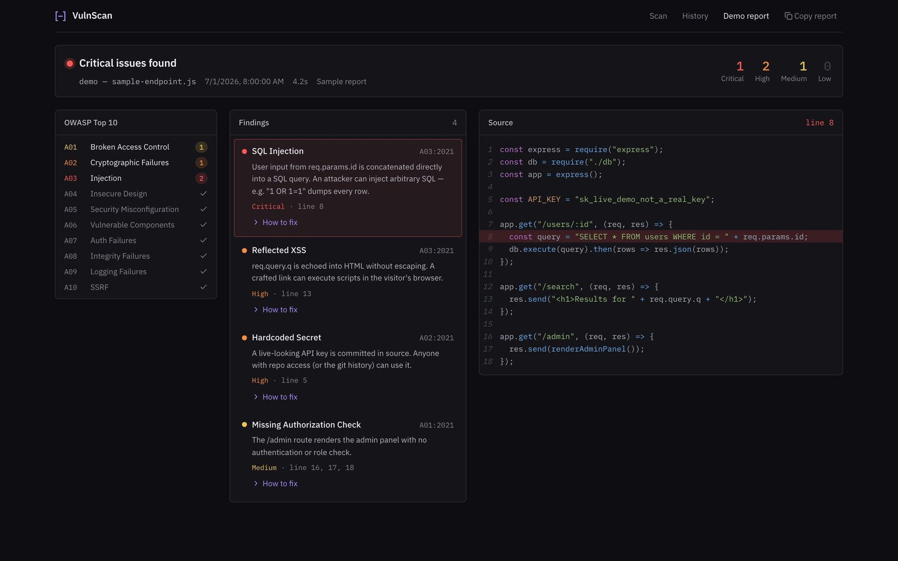

# VulnScan

[](https://vulnscan-xi.vercel.app)

Paste code or a GitHub link and it finds OWASP Top 10 bugs.

https://vulnscan-xi.vercel.app

## Run it

```bash
npm install
npm run dev
```

Needs `VITE_SUPABASE_URL` and `VITE_SUPABASE_ANON_KEY` in `.env.local`.

MIT licence.
